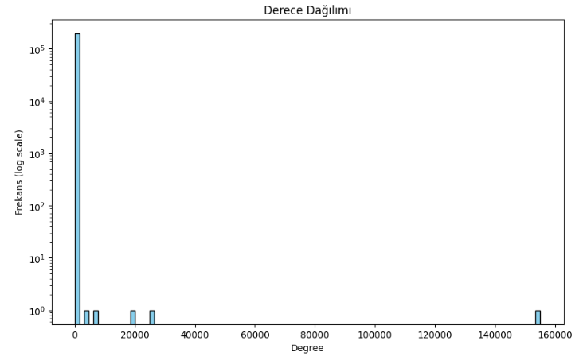
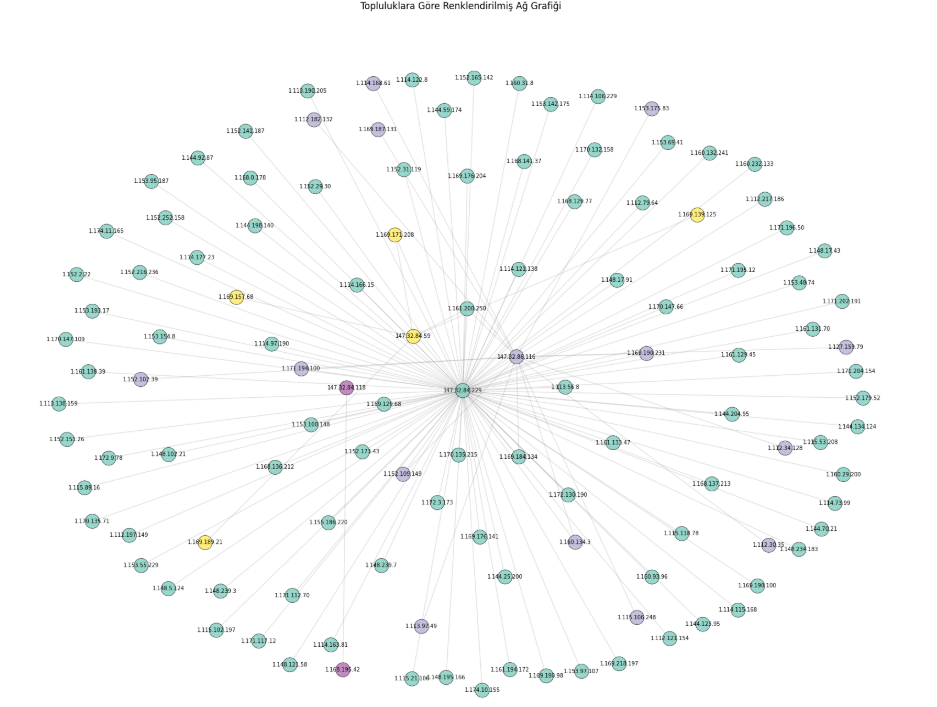
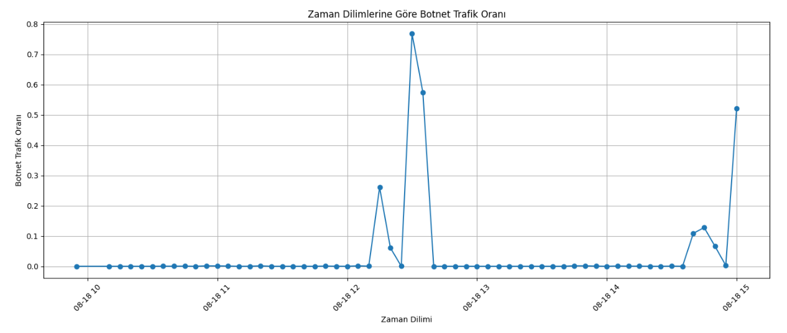
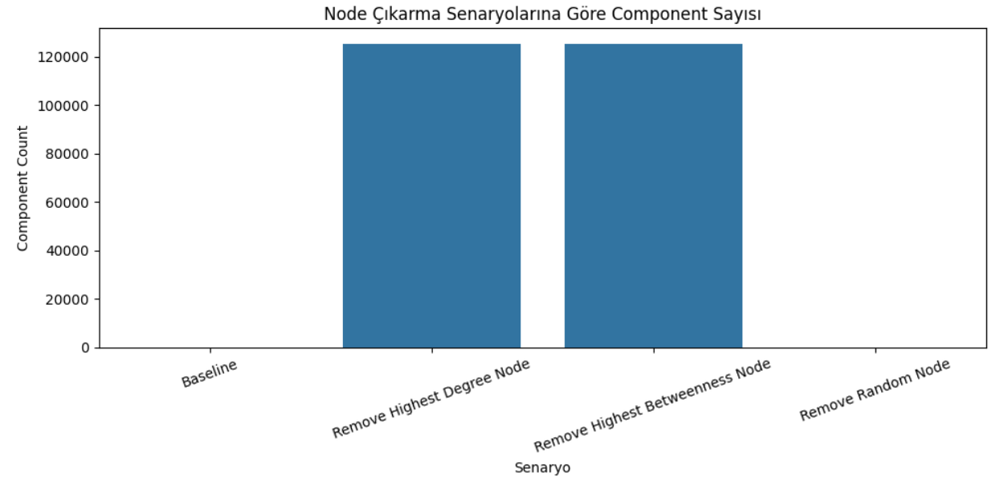

# Temporal Network Analysis of Stealth-like Botnet Traffic

Social Network Analysis course term project - Software Engineering, Samsun University.

## About

This project models network traffic from the CTU-13 botnet dataset as a directed, weighted communication graph and applies social-network-analysis methods - centrality, community detection, temporal analysis and network-resilience analysis - to investigate whether stealth-like botnet behavior can be detected, and how it can be interpreted through structural network metrics.

## Research question

Can stealth-like botnet behavior be detected within network traffic using temporal social-network-analysis methods, and how can that behavior be interpreted through structural network metrics?

## Dataset

CTU-13 Botnet Dataset.

- Source: https://www.stratosphereips.org/datasets-ctu13
- File used: `capture20110818.binetflow` - ~1,309,791 flow records, 33 fields, ~5 hours of traffic.
- Graph built from it: **197,824 nodes** (IP addresses) and **258,027 edges** (directed source→destination communication; edge weight = connection count between a pair).

The dataset is not included in this repository due to its size. Download it from the link above and place it in the project root.

## Methods

- **Graph modeling** - IPs as nodes, communications as directed, weighted edges; traffic split into 5-minute time windows for temporal analysis.
- **Basic metrics** - degree, density, diameter, clustering coefficient.
- **Centrality** - degree, betweenness, closeness, eigenvector, PageRank.
- **Community detection** - Louvain.
- **Temporal analysis** - how nodes, edges, largest component and botnet ratio evolve per time window.
- **Resilience** - effect of removing the highest-degree / highest-betweenness / a random node.

## Figures






## Libraries

- `pandas` - data processing
- `networkx` - graph construction and network metrics
- `python-louvain` - community detection
- `matplotlib`, `seaborn` - visualization
- `numpy` - numerical operations

## Setup

```bash
git clone https://github.com/baharerol/stealth-like-botnet-sna-analysis.git
cd stealth-like-botnet-sna-analysis
pip install -r requirements.txt
```

## Run

1. Download the dataset and place it in the project root.
2. Run the notebooks in order, cell by cell:
   - `01_data_preprocessing_and_graph_creation.ipynb`
   - `02_community_and_resilience_analysis.ipynb`

## Key findings

**Network structure**
- Large but sparse: average degree ≈ 2.61, approximate diameter ≈ 10, clustering coefficient ≈ 0.0001.
- Heavy-tailed, hub-dominated degree distribution (consistent with scale-free structure) - most nodes have 1–2 connections while a few hubs dominate, producing a star-like communication pattern.

**Central nodes**
- `147.32.84.229` is the top node by degree (0.78), betweenness (0.25) and PageRank (0.23) - the network's dominant hub, interpreted as a potential control/coordination point.
- Different measures highlight different nodes: `147.32.80.9` ranks top on closeness, `147.32.84.59` on eigenvector centrality - i.e. the most-connected node is not the fastest-reaching or the most "influentially connected" one.

**Communities**
- Louvain found 26 communities with modularity 0.54 (a strong, meaningful partition). The largest (community 0) holds ~130,844 nodes.

**Stealth-like behavior**
- Of 5,301 stealth-like nodes, 4,655 fall in community 0, but they appear across 18 different communities rather than forming one isolated group - they blend into normal traffic, which matches the defining characteristic of stealth behavior.
- Temporally, botnet traffic is bursty: its share stays low in most 5-minute windows but spikes to ~75% in short periods, indicating periodic rather than continuous activity.

**Resilience**
- Removing the highest-degree or highest-betweenness node shatters the graph (connected components jump from 7 to ~125,524); removing a random node barely changes it. The network is fragile to targeted attacks but robust to random failures.

## Limitations

- Only one CTU-13 capture is analyzed; other botnet types or scenarios may behave differently.
- Some metrics use approximate / subgraph-based computation due to the network's size.

## Future work

- **Quantify central-node detection.** Compare the centrality ranking directly against CTU-13's per-host botnet labels (e.g. precision@k, ROC-AUC) to measure how well high centrality actually identifies labeled botnet hosts - turning the qualitative "potential C&C" reading into a measured result.

## Author

Bahar Erol 

## License

Academic use. The CTU-13 dataset is subject to its own license terms.
